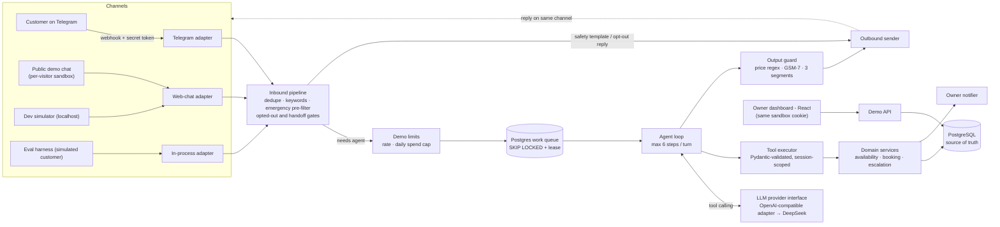
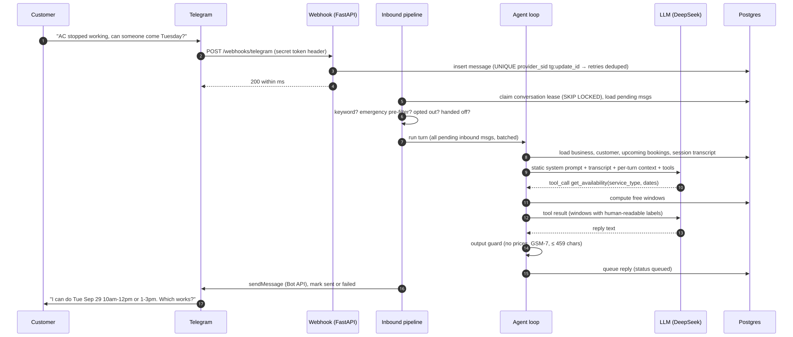
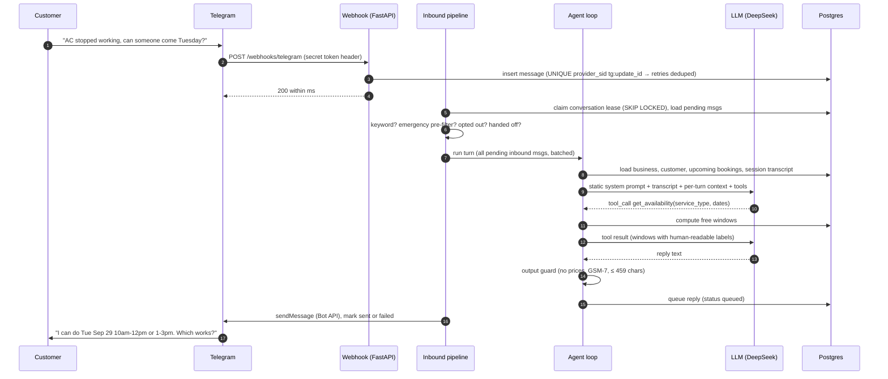
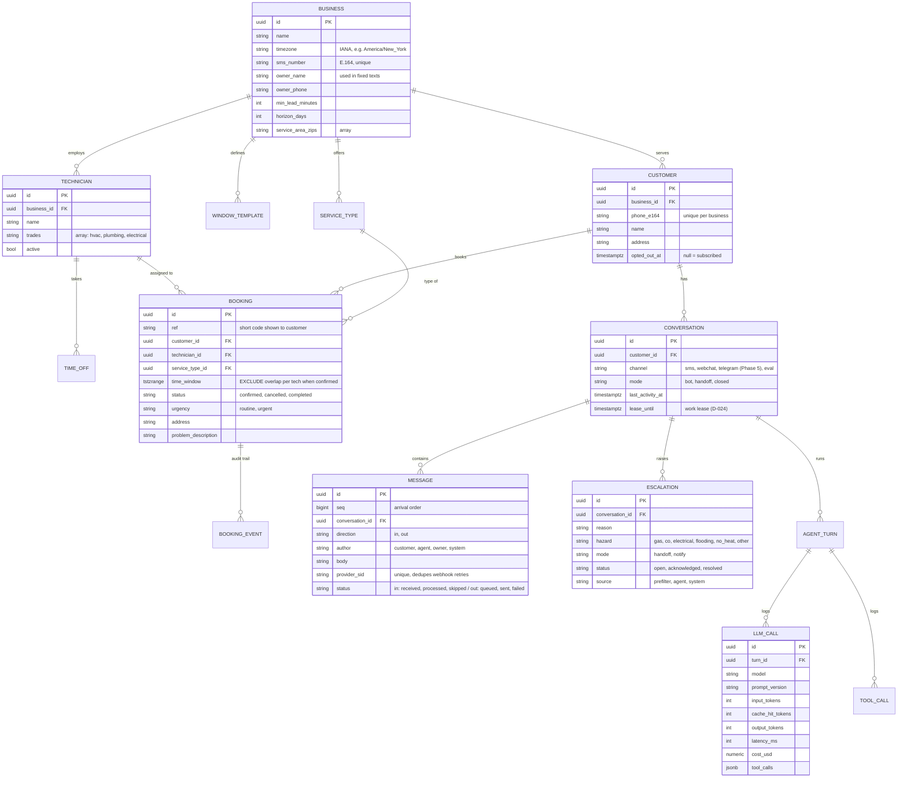

# SMS Booking Agent: Design (Phase 0)

Status: Phase 0 design, updated with Phase 1 and Phase 2 findings (2026-09-29), the Phase 5 channel plan (no Twilio; a public demo and a Telegram bot instead), and the Phase 3 eval harness (2026-11-22) · Decision IDs (D-xxx) refer to [`DECISIONS.md`](../DECISIONS.md)

## 1. Problem and goals

Small HVAC, plumbing, and electrical shops (1–10 technicians) lose jobs because nobody answers customer texts while everyone is on a job. The agent answers inbound SMS on the business's number and does the following:

1. Collects name, address, service type, problem description, urgency, and preferred time windows.
2. Books a real, conflict-free arrival window with a qualified technician.
3. Confirms the booking, and handles reschedules and cancellations.
4. Hands off to the owner when it should not act alone: emergencies, upset customers, price questions, out-of-scope requests, or uncertainty.

The agent is built to SMS limits (GSM-7 text, at most three segments, carrier keywords). The deployed project doesn't send real SMS: visitors reach it through a public web demo and a Telegram bot, and the same SMS rules apply there (D-033, §12).

**Success criteria for this project.** The success criteria are measured, not asserted (Phase 3–4 eval harness):

| Metric | Target (initial, revisit after first eval run) |
|---|---|
| Double-bookings | **0**, guaranteed by the DB, not the model |
| Emergency handling (safety msg + escalation, no booking) | ≥ 98% on emergency scenarios; every miss is listed individually |
| Correct escalation rate | ≥ 90% |
| Task success (normal booking / reschedule / cancel) | ≥ 85% |
| Cost per conversation | < $0.01 on the default model |

**Non-goals** (from the spec): invoicing, payments, voice, a full CRM, multi-tenant billing, and a technician app. v1 serves **one business per deployment**. The schema carries `business_id` everywhere so multi-tenancy stays possible later, but none of it is built. The one exception is the public demo, which gives each visitor a private copy of the seed business (D-034); there is still no onboarding, billing, or settings UI.

**Fixed inputs from the owner (2026-09-26):**

- LLM: the DeepSeek V4 family only.
- Budget: **under $10/month**, all-in.
- Cloud: decided at Phase 6.
- Pilot: a portfolio project with friendly testers, no real business.
- Seed business: fictional ("Brightwater Home Services"), time zone `America/New_York`.
- Channels (2026-11-22): no Twilio. The deployment is a public web demo plus a Telegram bot (D-033).

## 2. Architecture





**The core idea is layers of decreasing determinism.** Everything that must *never* go wrong is handled by plain code before or after the LLM: opt-out, emergencies, double-booking, price leakage, and data access scope. The LLM does only what needs language understanding: extracting details from messy texts, asking good follow-up questions, and choosing which tool to call. If the model misbehaves, the worst outcome is a bad SMS reply or an unnecessary escalation, never a double-booking or a missed safety message on a keyword-detectable emergency (D-001, D-002).

**One code path for all channels.** Telegram, the web chat (public demo and dev simulator), and the eval harness all call the same `handle_inbound(channel, business, from_number, body)` function. Only the transport differs, so the evals measure the production path (D-013). Twilio would be one more adapter on the same function; it isn't built (D-033).

## 3. Main flow: one customer turn





The webhook acknowledges Telegram immediately and the agent runs asynchronously. One turn can take several LLM calls, and a slow webhook response makes Telegram redeliver the update. The public web chat follows the same steps from the pipeline on, without the webhook hop: the browser posts the message and polls for the reply. The diagram was first drawn for Twilio, and the shape is the same (D-033). A process crash mid-turn cannot lose a message: the message row stays `received` until processed, and the queue re-claims it (D-012).

**Pipeline order.** Each step can end the turn without an LLM call. The order changed in Phase 1: the emergency pre-filter now runs *before* the opted-out and handoff gates (D-025, D-028).

1. **Dedupe.** A duplicate provider SID is ignored (unique index, so it holds under concurrent retries).
2. **Keywords.** `STOP`, `STOPALL`, `UNSUBSCRIBE`, `CANCEL`, `END`, `QUIT`, `OPTOUT`, and `REVOKE` as the whole message (case and surrounding punctuation ignored), plus natural phrasings like "stop texting me", mark the customer opted out and send one confirmation. `START`, `UNSTOP`, and `YES` re-subscribe, but only an opted-out customer: a subscribed customer's "Yes" is a booking confirmation and goes to the agent. `HELP` and `INFO` return fixed text (D-020, D-028).
3. **Emergency pre-filter.** A keyword/regex match escalates as `emergency` with handoff, sends the fixed safety template for that hazard, and ends the turn. It runs even when a human already owns the conversation, and even for opted-out customers, who get no text but whose owner is paged. Tuned for recall (D-003, D-004).
4. **Opted-out gate.** Other messages from an opted-out customer are marked `skipped`. No reply goes out, and the owner is alerted so the lead isn't lost.
5. **Handoff gate.** If a human owns the conversation, the message is stored and the owner is notified, with no bot reply.
6. **Agent loop.** Runs only if steps 1–5 did not end the turn. If it raises, the customer gets the fixed fallback text and the conversation escalates as `system_error`.

A batch can mix these: "HELP" followed by "my AC is broken" gets the help text and an agent turn for the second message.

Phase 5 adds the demo limits between steps 5 and 6 (D-037). Over a limit, the customer gets a fixed text instead of an agent turn. Steps 1–5 still run first, so keywords and safety messages never depend on the demo's budget.

**Claiming work** (D-024). A worker claims a conversation by writing a lease (token plus expiry) in a short transaction, processes it with no transaction held open across LLM calls, and releases the lease. Texts that arrive mid-turn get a follow-up turn before the release (up to three), so a customer who keeps typing is never left waiting on the poller. A crashed worker's lease simply expires. Each tool call commits on its own, so a booking that succeeded stays booked even if a later step of the turn fails.

## 4. Agent design

**Tool set.** Five tools, fixed. Arguments are Pydantic models, and the JSON Schema sent to the LLM is generated from them (D-001):

| Tool | Arguments (LLM-supplied) | Server-side behavior |
|---|---|---|
| `get_availability` | `service_type`, optional `earliest_date`, `latest_date`, `part_of_day` | Returns ≤ 6 free windows, each with a `slot_id` and a label like "Tue Sep 29, 10am-12pm" (ASCII hyphen, D-027). When nothing matches, it says why and returns the nearest other openings in the same call. |
| `create_booking` | `service_type`, `slot_id`, `customer_name`, `address`, `zip`, `problem_description`, `urgency` | Re-checks availability, assigns a technician, and inserts inside a transaction. Idempotent. |
| `reschedule_booking` | `booking_ref`, `new_slot_id` | Moves the booking in place and writes an audit event |
| `cancel_booking` | `booking_ref`, optional `reason` | Idempotent. Cancelling an already-cancelled booking returns `already_cancelled`. |
| `escalate_to_owner` | `reason` (enum), `summary`, optional `hazard` | The **server** applies the escalation policy: handoff or notify (see below) |

**Session scoping.** Tool arguments never include `customer_id`, `business_id`, or a phone number. Identity comes from the conversation session on the server. A prompt-injected "cancel all bookings for 555-0199" has no way to name another customer, because `booking_ref` lookups are filtered by the session's customer (D-010).

The `service_type` argument is an enum of the business's own service codes, so the model can't invent one. A `slot_id` is the window's local start with its UTC offset (`2026-10-06T08:00-04:00`); one without an offset is read as the business's local time. Every tool call runs in its own transaction.

**Errors are data.** Invalid arguments and domain failures (`slot_unavailable`, `outside_service_area`, `booking_not_found`) return a structured tool result the model can recover from. For example, `slot_unavailable` includes alternative windows. They do not raise exceptions, and a crashing tool returns a generic `internal_error` result rather than a stack trace.

**One response, several calls** (D-031). If a response holds a handoff-mode escalation, that call runs first and the other calls in the response are skipped. Nothing gets booked through an emergency, whatever order the model listed its calls in.

**Loop limits.** At most **6 LLM calls per turn**, a 45-second wall-clock budget, a 20-second timeout per call, and one retry for timeouts, rate limits, and 5xx responses. The sixth call is made with `tool_choice="none"`, so the model has to answer in words (D-031). When any limit is hit, the customer gets a fixed fallback message ("Thanks, we got your message and someone will follow up shortly"), and the conversation escalates with reason `system_error`. The customer is never left without a reply. The agent reports these failures to the pipeline as data (`step_limit`, `time_limit`, `llm_error`, `guard_failed`, `error`), and every turn is recorded with its outcome.

**Escalation policy.** A server-side table decides the mode. The LLM only classifies the reason (D-011):

| Reason | Mode | Bot keeps talking? |
|---|---|---|
| `emergency` | handoff, plus fixed safety template for the hazard | No |
| `upset_customer`, `human_requested`, `uncertain`, `out_of_scope` | handoff, plus fixed handoff message | No |
| `price_quote` | notify: the owner gets pinged, and the agent says pricing comes from the owner | Yes, it can still book |
| `urgent_no_availability` | notify, and the earliest window is offered | Yes |
| `system_error` (server-raised) | handoff | No |

Off-topic chit-chat ("what's the weather?") gets a one-line redirect and **no** escalation. Escalating everything would drown the owner.

**Conversation state.** Nothing lives in model memory (D-005). Each turn, the prompt is rebuilt from the DB (D-030):

- The static system prompt, which is versioned, including the business profile: services, arrival windows, and service area.
- Every earlier turn of this session, **replayed exactly as stored** in `agent_turns.messages`: the context note and customer text, the tool calls and results, and the reply that was sent.
- One new user message: a context note, then the customer's new text. The note holds the current local date and time, a date table for the booking horizon ("Tue Sep 29 = 2026-09-29 (today)"), what's on file for the customer, and their **upcoming confirmed bookings, read fresh from the DB**. It also lists, once, anything that happened since the agent last spoke: keyword replies, safety templates, owner texts, or the fallback.

The model looks dates up instead of computing them, and the prompt tells it the newest context block overrides anything earlier.

A session ends after 24 hours of inactivity, which keeps the context short and stops stale offers from carrying over (D-021). A conversation in handoff mode never times out: it stays with the owner until they resolve the escalation (D-025).

**Prompt layout for caching.** The static system prompt and business profile come first. Every turn only **appends** (context note → customer text → tool calls → reply), so earlier messages are never rewritten. A test checks that turn 2's prompt is turn 1's final prompt plus the reply plus the new message, byte for byte. DeepSeek caches prompt prefixes automatically, and cache-hit input costs about 2–3% of the cache-miss price. An append-only layout keeps most input tokens on the cheap path. Every LLM call logs `prompt_version` (a name plus a content hash) (D-015).

**Output guard.** Deterministic checks run before any send. First, typography models habitually produce is normalised rather than rejected: curly quotes, en and em dashes, ellipses, non-breaking spaces, and markdown bold. Then the reply is rejected if it has:

- A price: a currency/price regex (`$` + digits, "N dollars/bucks", "ninety-nine bucks").
- Any character outside GSM-7 after normalisation, such as an emoji (D-027).
- More than 459 characters, which is 3 concatenated SMS segments (D-029).
- No text at all.

On a violation, the model regenerates once with feedback. The rejected reply isn't stored in the transcript, because the customer never saw it. If it fails again, the customer gets a fixed fallback and the conversation escalates. More guards (for example, time-promise checks) are added only when evals show a real failure mode (D-016).

## 5. Safety design (emergencies)

This design uses **two detectors and one fixed response**:

- **Pre-filter.** Deterministic, runs before the LLM, and catches keyword-visible hazards:
  - Gas smell/leak and "rotten egg" smell.
  - A carbon monoxide alarm or detector going off.
  - Burning smell, smoke, sparks, or melting near electrical equipment.
  - Flooding or a burst pipe.
  - No heat combined with freezing temperatures or at-risk pipes.
- **LLM.** For hazards that are stated indirectly ("the outlet by the crib is hot and smells like plastic"), the model calls `escalate_to_owner(reason="emergency", hazard=...)`.
- **One fixed response.** Whichever detector fires, the server sends the **fixed template** for that hazard and hands off to the owner. The LLM never writes safety text and never books during an emergency.

**Recall over precision.** A false alarm costs one extra safety text and an owner ping. A miss can cost a life. Templates are worded conditionally ("If you smell gas, leave the building now…") so a false positive reads as reasonable advice, not a misfire (D-004). The eval set includes **emergency look-alikes** to measure false positives, such as "install a gas water heater" or "smelled burning last month, electrician fixed it".

Draft templates (the business owner should review these before any real use):

| Hazard | Template (draft) |
|---|---|
| Gas | If you smell gas, leave the building now. Don't flip switches, use phones inside, or light anything. Once outside, call 911 or your gas utility's emergency line. I'm alerting {owner} right now. |
| Carbon monoxide | If your carbon monoxide alarm is going off, get everyone, pets included, outside to fresh air now and call 911. Don't go back in until responders say it's safe. I'm alerting {owner} right now. |
| Electrical | If you see sparks or smoke or smell burning, stay away from it. If you can safely reach your breaker panel, switch off that circuit. If there's any fire or smoke, get out and call 911. I'm alerting {owner} right now. |
| Flooding | If water is flooding, shut off your main water valve if you can do it safely, and keep away from outlets or electrical equipment near the water. I'm alerting {owner} right now. |
| No heat, freezing | If anyone is at risk from the cold, please go somewhere warm. Don't use an oven or grill to heat your home. I'm alerting {owner} right now. |

## 6. Scheduling and time zones

**Model: arrival windows** (D-007). The business defines weekly window templates in local wall time, for example weekdays 8–10, 10–12, 1–3, 3–5 and Saturday 9–11, 11–1. Each job occupies **one window on one technician**. The customer books a window, not a technician. The server assigns the least-loaded qualified technician that day, with ties broken by technician id so tests are deterministic. The agent only ever promises the window ("arrives between 10am and 12pm"), which follows the spec's rule against unverifiable arrival times.

**Availability.** A window is available when all of the following hold:

- It starts at least `min_lead` (default 2 h) from now.
- Its local date falls within `horizon` (default 14 days, counting today as day 1).
- At least one active technician with the right trade has no time off overlapping it.
- That technician has no confirmed booking overlapping it.

The service must be `bookable`. Multi-visit jobs and jobs that need an estimate first (installs, panel upgrades) are not, and the agent routes them to the owner as a quote. The customer's ZIP must be in the business's service area.

**Time zones** (D-009):

- All timestamps are `timestamptz` and stored in UTC.
- The business holds an IANA zone.
- Window templates are local wall times, converted to UTC **per date** with `zoneinfo`. That way, 8am on Nov 2 (EST, UTC-5) and 8am on Oct 30 (EDT, UTC-4) both come out right.
- Customer-facing times are always shown in the business's zone.
- Phase 1 tests cover the 2026-11-01 fall-back and 2027-03-14 spring-forward transitions.

**No slot holds in v1** (D-008). Between "here are your options" and "yes, Tuesday", another customer could take the slot. `create_booking` re-checks inside its transaction and returns `slot_unavailable` with alternatives, which the agent re-offers. At 1–10 technicians and low concurrency, this is rare and cheap to recover from. Holds would add TTL cleanup and a new failure mode.

## 7. Data model





Tables not expanded above are `service_types` (code, label, trade, bookable), `window_templates` (weekday, start_local, end_local), `technician_time_off` (tstzrange), `booking_events` (created/rescheduled/cancelled with old and new window and actor), `agent_turns` (trigger messages, steps, outcome, prompt version), and `tool_calls` (name, args, result, status, latency). Migration 0001 (Phase 1) creates the core schema. Migration 0002 (Phase 2) adds `agent_turns` (including `messages`, the turn's slice of the transcript), `llm_calls`, `tool_calls`, and `messages.agent_turn_id`, which links each message to the turn that consumed or wrote it.

**Planned for Phase 5** (one migration, not yet built; not in the diagram above):

- `demo_sandboxes`: token hash, `business_id` (cascade delete), `created_at`, `last_active_at`, creator IP hash. One row per visitor's private copy of the seed business (D-034).
- `channel_identities`: `(channel, external_id) → customer_id`, unique on `(channel, external_id)`. Links a Telegram chat id to a customer, since Telegram gives no phone number (D-035).
- `telegram_link_tokens` (or columns on `demo_sandboxes`): single-use, short-lived tokens for the `t.me/<bot>?start=<token>` deep link.
- `Channel` gains `telegram`.

**Integrity rules enforced by Postgres, not app code** (D-006):

- `bookings`: `EXCLUDE USING gist (technician_id WITH =, time_window WITH &&) WHERE (status = 'confirmed')` (needs `btree_gist`). Two confirmed bookings can never overlap on one technician, regardless of races, retries, or model behavior.
- `bookings`: partial unique index on `(customer_id, service_type_id, lower(time_window)) WHERE status = 'confirmed'`. A repeated `create_booking` for the same customer, service, and window returns the existing booking instead of creating a second one. This is idempotency by natural key.
- `messages.provider_sid` is UNIQUE, so webhook retries are no-ops (Telegram stores `tg:<update_id>`).
- `customers (business_id, phone_e164)` is UNIQUE.
- `conversations`: partial unique index on `(customer_id, channel) WHERE mode <> 'closed'`, so two simultaneous first texts from a new number open one conversation.

Concurrent races: when two customers book the last window, one insert hits the exclusion constraint. The service catches it and tries the next qualified technician. If none is free, it returns `slot_unavailable` with alternatives. READ COMMITTED is enough because the constraint does the serialization.

The Phase 1 race tests (a barrier makes every transaction find the window free before any of them writes) found one thing the design missed: several transactions inserting mutually conflicting rows can **deadlock** under an exclusion constraint, and Postgres only breaks each cycle after `deadlock_timeout` (1 s). With eight writers on one technician this became 20 to 35 seconds of back-to-back deadlocks. Writers now take a `FOR NO KEY UPDATE` lock on the technician row inside the write's savepoint, so they queue instead of deadlocking. The lock is for liveness only; the constraint remains the guarantee, and a deadlock that still happens is caught and retried (D-026).

## 8. LLM provider and cost

**Provider interface** (D-014). A single `complete()` interface takes system, messages, tools, and model, and returns an `LLMResult` with message, tool calls, usage, latency, and cost. It has two implementations:

- `OpenAICompatibleProvider`. DeepSeek exposes an OpenAI-compatible API, so the same adapter also works with OpenAI, OpenRouter, US hosts of DeepSeek's open weights, or a local vLLM server. Switching is a config change.
- `FakeProvider`. It replays scripted responses, so the agent loop's control flow is unit-tested with zero API cost and full determinism.

**Models.** The default agent is `deepseek-flash` (DeepSeek-V4.1-Flash) in non-thinking mode, and `deepseek-v4-pro` serves as a comparison model. Thinking is **on by default** in DeepSeek's API, so the adapter turns it off explicitly (D-032). The eval harness decides whether Flash's tool calling is good enough. "Thinking on vs. off" is one of the planned experiments.

**Price basis** (DeepSeek pricing page, fetched 2026-09-26, per 1M tokens):

| Model | Cache hit | Cache miss | Output |
|---|---|---|---|
| deepseek-flash | $0.003 | $0.15 | $0.60 |
| deepseek-v4-pro | $0.022 | $0.66 | $1.98 |

These are off-peak prices; peak is double. Peak hours are 01:00–04:00 and 06:00–10:00 UTC on weekdays, which is late evening and pre-dawn US Eastern, so US daytime runs are off-peak. The cost calculator stores these as config and must be re-checked before relying on it.

**Estimated eval cost.** Assumptions: ~7 customer turns, ~13 agent LLM calls of ~4k input tokens each at a 75% cache-hit rate, ~2k output tokens, a Flash-simulated customer, and one judge call. Script: `scripts/estimate_eval_cost.py`.

| Run | Flash (off-peak) | Pro (off-peak) |
|---|---|---|
| Per conversation | ~$0.005 | ~$0.015 |
| Dev split (~60 scenarios) | ~$0.30 | ~$0.90 |
| Full suite (250) | ~$1.20 | ~$3.70 |

Budget these at 2× until real token counts replace the assumptions.

**Monthly budget plan (< $10):**

- **LLM evals, about $5–7** in the months of Phases 3–4. Roughly 15 dev-split runs plus 2 full Flash runs plus one Pro dev-split comparison, all off-peak.
- **LLM for the public demo, at most about $3.** A daily cap of $0.10 (D-037), about 20 conversations a day at the estimate above. Once the demo is live, eval runs are occasional, so the two don't peak in the same month.
- **CI, $0.** No LLM calls on push (D-019).
- **Hosting, target $0.** Free tiers only: no managed Redis, no paid managed Postgres (D-022).
- **Messaging, $0.** The web chat and Telegram cost nothing per message. Twilio was the main budget risk and is no longer used (D-033).

## 9. Evaluation design

Set in Phase 0 because they shape the schema and logging (D-018), and built in Phase 3 (D-038 to D-042). How the harness works in practice is at the end of this section.

- **Scenarios** are YAML files, targeting 250 total:

  | Category | Count |
  |---|---|
  | Normal booking | 50 |
  | Ambiguous or incomplete | 35 |
  | Reschedule | 25 |
  | Cancel (including a bare "cancel") | 20 |
  | Angry | 20 |
  | Clear emergency | 20 |
  | Subtle emergency (no keyword hit) | 15 |
  | Emergency look-alike | 15 |
  | Price request | 20 |
  | Off-topic, out-of-scope, or prompt injection | 20 |
  | Opt-out, STOP, HELP | 10 |

  Each scenario pins a **frozen clock**, a DB fixture, and a customer persona with hidden facts the customer reveals only when asked.
- **Customers.** An LLM-simulated customer handles adaptive scenarios. Emergency, opt-out, and injection cases use **scripted customers** with exact messages, because they don't need adaptivity and should be deterministic.
- **Grading.** Deterministic first: final DB state (booking count, status, service trade, window inside the persona's acceptable set, address) and the tool-call trace (no `create_booking` during an emergency, escalation reason ∈ expected set, safety template in the first reply after disclosure, no price regex hits, no bot messages after opt-out). An LLM judge answers only narrow yes/no rubric questions about tone and SMS-appropriateness, and it is calibrated against ~40 human-labeled transcripts, with agreement reported.
- **Honesty controls.**
  - A stratified **70/30 dev/test split**, where the test split runs only at milestones so prompts are not overfit to the eval set.
  - Wilson 95% confidence intervals on every rate.
  - Repeated runs (k = 3) on the dev split for comparisons, to measure non-determinism.
  - Simulator-failure detection. Transcripts where the simulated customer broke character are flagged and excluded, with a count.
- **Metrics:**
  - Task success rate, overall and per category.
  - Correct escalation rate, plus escalation precision and recall.
  - Emergency-handling accuracy, with misses listed by id.
  - Emergency false-positive rate on look-alikes.
  - Double-booking count, both constraint-violation attempts and a post-hoc overlap query.
  - Average turns, and cost and latency per conversation (p50/p95), taken from the same `llm_calls` table production uses.

**How the harness works (Phase 3).**

- **One run of one scenario.** A fresh copy of Brightwater is created under its own number, and the fixture is built on it through the domain services with the scenario's frozen clock (D-038). The customer's messages go through `handle_inbound` with `Channel.EVAL`. The clock moves a minute between messages. Afterwards the trace is read back from the production tables, and the run is graded. Runs go concurrently, four at a time by default, against a separate `booking_agent_eval` database wiped at the start of each run.
- **Scenario files.** `evals/scenarios/<category>.yaml`, with per-file defaults. Times without an offset are Brightwater's local time, converted per date. Expectations name what must be true at the end: new bookings (count, service, acceptable windows, address, ZIP, urgency), what happened to each fixture booking, escalation reasons required or forbidden, the emergency hazard, the safety message in the reply to the disclosing text, opt-out state, and reply regexes. `python -m evals validate` checks every scenario against the seed business: windows that can't be booked, unknown services or technicians, scripted customers where D-018 requires them, and the 70/30 split per category.
- **Universal checks** on every run: no double-booking, no agent failure, no price in model-written text, SMS limits, silence after an opt-out, and silence once the owner has the conversation. A run passes when every check passes (D-039).
- **Category definitions are tested.** Each clear emergency's disclosing text must trip the pre-filter, and no subtle emergency's text may. So the clear category measures the deterministic layer plus the templates, and the subtle one measures the model.
- **The simulated customer** gets the scenario's date and time, the persona, and the rule to answer `[DONE]` when finished. It stops when the business goes silent (a handoff), and it is caught breaking character by patterns and by the judge (D-040).
- **The judge** makes one call per transcript with five yes/no questions, reported separately and marked uncalibrated. The in-character question is asked only about simulated customers (D-041).
- **Outputs.** `evals/runs/<run id>/` holds `run.json` (model, temperature, prompt version, git commit, split, milestone), `results.jsonl` (one full trace per run), `summary.json`, and `report.md`. `python -m evals report` rebuilds the last two from the results, so metric definitions can change without re-running.
- **Cost.** The CLI refuses a run whose estimate tops `--max-cost` and stops starting conversations once real spend reaches it (D-042). The first two live runs, 16 dev scenarios each (2026-11-22), cost about $0.0005 a conversation all-in, with an 86-92% prompt cache hit rate.

## 10. Risks and open questions

1. **DeepSeek data residency.** DeepSeek's privacy policy says it processes and stores personal data in the PRC. That is fine for synthetic dev and eval data. Demo visitors may type real names and addresses anyway. Mitigations: the demo asks for made-up details on every page, Telegram gives us no phone number (D-035), and sandboxes are deleted 48 hours after last use (D-034). Because the adapter is OpenAI-compatible, the same open-weights model can be pointed at a US-hosted endpoint by config. **Owner decision needed before the link is shared in Phase 7:** are these mitigations enough, or should the demo run on a US-hosted endpoint?
2. **Twilio vs. a $10 budget. Resolved by D-033.** Twilio's free trial can't send custom replies, and real sending needs a paid account plus US sender registration. The project drops Twilio and deploys a public web demo plus a Telegram bot, at $0 per message.
3. **"CANCEL" is a carrier opt-out keyword.** On real SMS, a customer who texts just "Cancel" gets opted out by the carrier. Without Twilio no carrier is involved, but the keyword rules stay on every channel so the agent remains SMS-ready and the evals measure SMS behaviour (D-033). A demo visitor who sends just "cancel" is opted out and can send START. The demo copy invites "cancel my appointment".
4. **Flash tool-calling quality is unknown.** The evals decide. The fallback is Pro for agent turns only, at about 3× the cost.
5. **Serverless background work.** Some serverless platforms throttle CPU after a response is returned. Turn processing is written as `process_conversation(id)`, callable from either an in-process worker or an HTTP task endpoint, so the Phase 6 platform choice doesn't force a rewrite.
6. **Same-family judge.** With one provider, the judge is a DeepSeek model grading DeepSeek. This is mitigated by narrow binary rubrics and human-label calibration, and it is reported as a limitation.
7. **Safety templates** are drafts written by an engineer, not reviewed by a safety professional.
8. **A public URL invites abuse.** Scripts can burn the LLM budget or flood sandboxes. Rate limits per sandbox and per IP, plus a daily spend cap, all counted in Postgres (D-037). A CAPTCHA on sandbox creation is held in reserve.
9. **A sandbox isolation bug would leak one visitor's data to another.** Every demo endpoint resolves the business from the cookie, never from a parameter, and tests check every endpoint across two sandboxes (D-034).
10. **The Telegram webhook needs public HTTPS.** End-to-end Telegram testing waits for the Phase 6 deployment. Until then the adapter is tested against a fake Telegram API.

## 11. Repo layout

```
app/
  main.py              FastAPI app factory, lifespan (starts the worker)
  worker.py            queue poller: answers messages a crashed worker left behind
  config.py            pydantic-settings; all secrets from env
  db/                  SQLAlchemy models, session, Alembic migrations
  domain/              clock, availability, booking, escalation, SMS rules (no LLM imports)
  pipeline/            inbound handling: dedupe, opt-out, handoff, safety pre-filter, agent port
  agent/               loop, tools, executor, context, output guard, prompts/, providers/
  channels/            webchat now; telegram in Phase 5
  api/                 web-chat simulator now; demo API and Telegram webhook in Phase 5
  demo/                sandbox create/clone/cleanup and demo limits (Phase 5)
dashboard/             React app: demo customer chat and owner dashboard (Phase 5)
evals/                 scenario schema, fixtures, runner, customers, graders, judge, metrics, CLI
  scenarios/           250 scenarios, one YAML file per category
  runs/                run outputs (git-ignored)
tests/                 pytest; real Postgres, no SQLite (D-017)
docs/                  DESIGN.md, diagrams/
DECISIONS.md · RESULTS.md (Phase 4) · README.md
docker-compose.yml · Dockerfile · .env.example
```

`app/domain` must not import from `app/agent`, `app/pipeline`, or any LLM or HTTP client. That rule enforces "the system works with zero AI in it", and `tests/test_architecture.py` checks it on every run. `app/pipeline` owns the agent *port* (a Protocol) and may not import the agent implementation either.

## 12. Public demo and Telegram (Phase 5 plan)

Without Twilio (D-033), the deployment is a demo site that a visitor can try in seconds. In it the visitor plays **both roles**: they chat as a customer, then switch to the owner dashboard and see the business side of what they just did.

**What the visitor sees.** One page, two tabs:

- **Customer:** a phone-style chat with an "under the hood" panel beside it, showing each turn's tool calls with arguments and results, tokens and cache hits, cost, and the SMS segment count of each reply. There is a "Chat on Telegram" button, a banner asking for made-up names and addresses, and suggestions for what to try (book, reschedule, ask a price, report a gas smell).
- **Owner:** a calendar of bookings by technician, the escalation inbox with a resolve action, the conversation list with each conversation's channel, and a small stats strip (bookings, escalations, cost per conversation).
- A **Reset demo** button on both tabs.

**Sandboxes** (D-034).

1. A first visit clones the seed business: technicians, service types, windows, service area, and a few fake bookings dated relative to today. It is stored as a `demo_sandboxes` row and sets an HttpOnly cookie.
2. Every `/api/demo/*` endpoint resolves the business from the cookie and never from a request parameter. The chat and the dashboard both see only that sandbox.
3. A cleanup job deletes sandboxes 48 hours after their last activity. Deleting the business cascades. Reset deletes the sandbox and creates a new one.

**Telegram** (D-035).

1. The button opens `t.me/<bot>?start=<link token>`, where the token is single-use and short-lived, separate from the cookie.
2. On `/start <token>`, the bot links the chat id to the sandbox's customer in `channel_identities`. The visitor is then one customer with two conversations, web and Telegram, both visible in their dashboard.
3. A chat that isn't linked gets a fresh sandbox, and the bot replies with that sandbox's dashboard link.
4. Inbound updates go through `handle_inbound` with `provider_sid = tg:<update_id>`. A sender in the worker delivers queued replies with `sendMessage`, retries on failure, and marks each message sent or failed.

**Limits** (D-037). 30 messages per sandbox per hour, 5 new sandboxes per IP per day, and a $0.10 daily LLM cap across the demo, all counted in Postgres. At the cap the agent is replaced by a fixed "the demo is resting" reply. Keywords, the emergency pre-filter, and the dashboard keep working.

**App** (D-036). One Vite + React + TypeScript app in `dashboard/`, served by FastAPI from the same origin as `/api/demo/*`. It polls every 2–3 seconds while visible. The localhost dev simulator stays as it is.

**Build order.**

1. Sandboxes, cleanup, cookie scoping, and the limits. Tests: two sandboxes can't see each other's data through any endpoint, cleanup, each limit.
2. The demo API, reusing the simulator's turn-inspection code.
3. The React app: Customer tab, then Owner tab. CI gains frontend type-check, lint, build, and component tests.
4. The Telegram channel: webhook auth, `/start` linking, duplicate updates, and the send and retry path, all tested against a fake Telegram API so CI stays offline (D-019).
5. Polish: demo copy, and README screenshots with the eval results.

Steps 1–3 alone make a complete demo. Telegram is tested end to end once Phase 6 gives it a public HTTPS URL.
